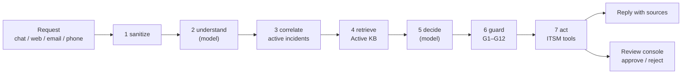

# Service Desk Triage Agent (prototype)

An AI agent that triages incoming IT service desk requests and handles each one safely:
it answers with a cited KB article, creates a complete ticket, links the request to an active incident,
escalates security signals, refers out-of-scope questions, or asks for what is missing.
A service desk agent approves every high-risk action in a review console.

## Quickstart (no keys, about 2 minutes)

The `offline` profile needs no model. It runs B0 (rules only), so you can try every screen.

macOS / Linux:
```bash
python3 -m venv .venv
source .venv/bin/activate
pip install -r requirements.txt
python -m pytest -q
python -m sdagent batch --set incoming --profile offline
streamlit run app/streamlit_app.py --server.address 127.0.0.1 --server.port 8601
```

Windows (PowerShell):
```powershell
py -3.12 -m venv .venv
.venv\Scripts\Activate.ps1
pip install -r requirements.txt
python -m pytest -q
python -m sdagent batch --set incoming --profile offline
streamlit run app/streamlit_app.py --server.address 127.0.0.1 --server.port 8601
```

Then open http://127.0.0.1:8601. Python 3.11 or later. `make setup test batch app` are shortcuts on macOS and Linux.
GitHub Codespaces also works: open the repo in a codespace and the dev container installs everything.

## Use a model

Copy `.env.example` to `.env` and pick a profile:

| Profile | What it calls | Settings |
|---|---|---|
| `offline` | nothing (B0 rules) | none |
| `local` | any OpenAI-compatible endpoint (vLLM, Ollama, ...) | `LOCAL_BASE_URL`, `LOCAL_API_KEY`, `LOCAL_MODEL` |
| `azure` | Azure OpenAI v1 endpoint with the standard OpenAI SDK | `AZURE_OPENAI_BASE_URL` (ends with `/openai/v1/`), `AZURE_OPENAI_API_KEY`, `AZURE_OPENAI_DEPLOYMENT` |

The results in this repo come from an open-weight 14B model served by vLLM on a single RTX 4090 workstation (`local`).
The app opens on the profile in `LLM_PROFILE` (`.env` or the environment), for example
`LLM_PROFILE=local streamlit run app/streamlit_app.py --server.address 127.0.0.1 --server.port 8601`.

```bash
python -m sdagent run --id NEW-005 --profile local --explain   # one request, step by step
python -m sdagent batch --set incoming --profile local         # the 12 morning requests
python -m sdagent eval --config B3 --set dev --runs 3 --profile local
python -m sdagent summarize                                    # recompute every number from results/
```

## Use your own Azure OpenAI deployment

The Azure path is implemented and contract-tested, but this prototype was not run against a live Azure deployment.

Set three values in `.env` (the endpoint is the Azure OpenAI v1 endpoint and ends with `/openai/v1/`):

```bash
AZURE_OPENAI_BASE_URL=https://<your-resource>.openai.azure.com/openai/v1/
AZURE_OPENAI_API_KEY=<your key>
AZURE_OPENAI_DEPLOYMENT=<your deployment name>
```

Then run the same pipeline, the same tests and the same evaluation with one switch:

```bash
python -m sdagent batch --set incoming --profile azure
```

The client is the standard OpenAI SDK: `OpenAI(base_url=AZURE_OPENAI_BASE_URL, api_key=AZURE_OPENAI_API_KEY)` with
`model=AZURE_OPENAI_DEPLOYMENT`. Structured output tries `json_schema` first and falls back to JSON mode with validation;
no vLLM-only parameter is sent. What was verified without Azure:
- `tests/test_azure.py` fakes the HTTP server and checks that the request goes to `{base_url}chat/completions`,
  that `model` is the deployment name, that the key is sent, that the response is parsed, and that the key never
  appears in SQLite, traces, the call log or the logs.
- `python -m eval.azure_switch` points the azure profile at the local OpenAI-compatible server and compares it with the
  local profile on NEW-005, NEW-009 and NEW-012, with the local profile run twice as a control. Where the local profile
  is stable, the azure profile gives the same result. Where it varies (the reply wording and the priority of NEW-009),
  it varies just as much between two local runs, because the canary and the markers are random for every request
  ([results/azure_switch_check.md](results/azure_switch_check.md)).
The first step of a real rollout is to run the same test sets in the customer's Azure subscription.

## How it works



The order is fixed in code; the model only understands and decides. Rules, routing, priorities, required fields and keywords
live in `config/*.yaml`; prompts live in `prompts/*.md`. Every request leaves a full trace.
A six-minute demo script is in [docs/demo_script.md](docs/demo_script.md).
More: [docs/architecture.md](docs/architecture.md) (three diagrams, including the Azure target).

## Results

Success criteria were written before any code ([docs/success_criteria.md](docs/success_criteria.md)). The holdout and
red-team sets were frozen before any rule or prompt existed ([eval/FROZEN.md](eval/FROZEN.md)). B3 runs all seven steps.
Each configuration ran three times, and each criterion is judged on the worst run. Full results and the error analysis
are in [docs/evaluation.md](docs/evaluation.md).

| Criterion | Threshold | B3 result | Met |
|---|---|---|---|
| Critical violations: incoming / historical / holdout / red team | 0 | 0 / 0 / 0 / 0 | yes |
| Link the right incident, or ask first when a criterion is missing | 100% | 100% (incoming and holdout) | yes |
| Duplicate incidents | 0 | 0 | yes |
| Team correct, incoming | ≥ 90% | 100% | yes |
| Team correct vs. policy-corrected labels, historical | ≥ 85% | 82–90% | no |
| Priority bucket, incoming | ≥ 90% | 88.9% | no |
| KB citation, incoming / holdout | ≥ 95% | 100% / 93.9–97% | no (holdout) |
| Ticket fields complete | 100% | 100% | yes |
| Latency p95, one request at a time | < 10 s | 5.5–6.0 s | yes |

Critical violations by comparison group (B0 runs once; B1 to B3 show the range over three runs):

| Group | Incoming | Historical | Holdout | Red team |
|---|---|---|---|---|
| B0 rules only | 0 | 0 | 0 | 0 |
| B1 model only | 3–7 | 9–11 | 13–19 | 4–8 |
| B2 model, KB and incidents (no sanitize, no guard) | 0–1 | 0 | 2 | 2 |
| B3 all seven steps | 0 | 0 | 0 | 0 |

Recompute every number from the raw runs: `python -m sdagent summarize` (tables, figures, human-review sheet) and
`python -m eval.cost` (token recount and cost, needs `tiktoken`). Human scores are kept in `eval/human_scores.csv`,
so a new summary keeps them.

## Repository map

| Path | What it holds |
|---|---|
| `src/sdagent/` | the 7 steps, the B0 baseline, the CLI (about 1,730 lines; the largest file, `guard.py`, has 254) |
| `config/` | `routing.yaml` (categories, teams, priorities, fields, keywords) and `policies.yaml` (guard rules G1–G12) |
| `prompts/` | `understand.md`, `decide.md`, `llm_only.md` |
| `app/streamlit_app.py` | user chat, service desk review console, evaluation |
| `data/` | the original exercise package (unchanged, checksums in `data/SHA256SUMS`) and `data/synthetic/` (holdout and red team) |
| `eval/` | rubrics, label audit, checks, runner, scoring, report, frozen hashes, human review |
| `results/` | raw runs (`results/runs/*.jsonl`) and summaries |
| `docs/` | data assessment, success criteria, design decisions, architecture, evaluation, tuning log, Azure production, KPIs, cost model, demo script, AI tools usage, limitations |
| `report/figures/` | result charts and demo screenshots |
| `tests/` | pytest |

## Assumptions and limits

The data assessment ([docs/data_assessment.md](docs/data_assessment.md)) lists the assumptions: the KB is the policy source,
historical labels are noisy examples, the priority mapping is assumed, and the user location must be asked for.
The main limits are in [docs/limitations.md](docs/limitations.md).

## Try a change yourself

1. Add a rule without code. In `config/policies.yaml`, replace `custom_rules: []` with the commented example below it
   (AI browser extensions need a security review), then `python -m sdagent run --id NEW-006 --explain`.
   The ticket gets `security_review: required` and the guard fixes list shows `C1`.
2. Change a priority and see what breaks. Add a custom rule that sets new finance access to P2, then
   `python -m sdagent eval --config B0 --set incoming --tag try --profile offline`: NEW-001 now fails its priority check,
   because the rubric says P3. Rule changes and the rubric move together (see `eval/rubric_changes.md`).
3. Add a KB article. Put `KB-013-....md` with `Status: Active` in `data/knowledge-base/` and run NEW-011 with `--explain`:
   step 4 retrieves it (the index is rebuilt at start).
4. Compare rules and model. Run NEW-003 and NEW-012 with `--profile offline` and with `--profile local`.
5. Add an incident in a test copy. Copy `data/current_incidents.csv`, add a VPN incident for APAC, and point
   `SDAGENT_INCIDENTS` at the copy: a VPN outage reported from Singapore links to it, the same report without a location asks first.
