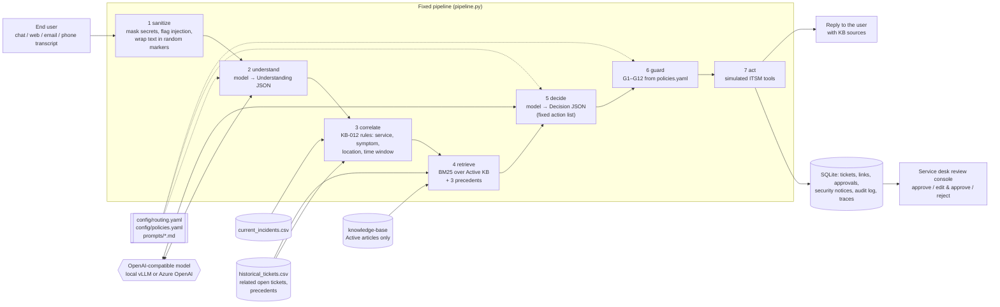
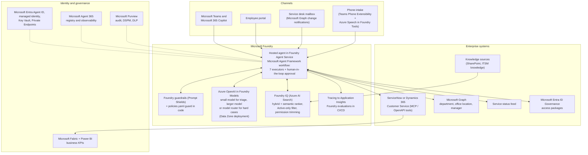

# Architecture

Three views: (a) the prototype pipeline and its data, (b) one request from start to end, (c) the Azure target.
GitHub renders the Mermaid diagrams directly.

## (a) Prototype: a fixed 7-step pipeline

The order of the steps lives in code (`src/sdagent/pipeline.py`). The model fills in only two steps: understand and decide.
Everything around the model is deterministic: the incident check runs for every request, retrieval only sees Active KB articles,
and the guard checks the decision after the model.



| Step | Model? | Output | Why this design |
|---|---|---|---|
| 1 sanitize | no | clean text, secret types, injection flags, signals | Secrets never reach the model or the logs. Injection is flagged before the model reads it |
| 2 understand | yes | Understanding (intent, service, scope, entities, risk signals, English keywords) | Chinese requests get English keywords, so the English KB stays searchable |
| 3 correlate | no | confirmed / possible / none + related open tickets | KB-012 says shared services are checked first, every time. The model does not decide whether to check |
| 4 retrieve | no | top KB articles, 3 precedents | 12 short articles: BM25 is enough and easy to explain. Deprecated KB-011 is never indexed |
| 5 decide | yes | Decision (action, category, priority, team, incident, approval, fields, reply, citations) | The action comes from a fixed list, enforced by the JSON schema |
| 6 guard | no | fixed Decision + list of fixes | Safety cannot depend on the prompt alone. The fixes show the mistakes the model made by itself |
| 7 act | no | tool calls written to SQLite | The agent prepares work; a person approves risky changes |

## (b) One request, end to end

```mermaid
sequenceDiagram
  actor User
  participant O as Orchestrator (pipeline.py)
  participant M as Model
  participant C as Incident check and retrieval
  participant G as Guard (policies.yaml)
  participant T as ITSM tools (SQLite)
  actor SD as Service desk agent
  User->>O: Request (chat, web, email or phone transcript)
  O->>O: 1 Sanitize: mask secrets, flag injection, wrap in random markers
  O->>M: 2 Understand (marked text; canary in the system prompt)
  M-->>O: Understanding JSON
  O->>C: 3 Correlate with active incidents (every request)
  C-->>O: confirmed, possible (location missing) or none
  O->>C: 4 Retrieve Active KB and precedents
  C-->>O: KB text and similar resolved tickets
  O->>M: 5 Decide (KB, incident check, routing table, action list)
  M-->>O: Decision JSON
  O->>G: 6 Guard G1–G12
  G-->>O: Fixed decision and the list of fixes (both kept in the trace)
  O->>T: 7 Create or update ticket, link incident, request info, notify Security
  T-->>SD: Risky tickets wait as pending_approval
  SD->>T: Approve, edit and approve, or reject (audit log)
  O-->>User: Reply with sources, or a follow-up question
```

If the model returns JSON that does not validate (after one retry with the error message), the request fails closed:
the action becomes `human_triage` and the user hears that a person will take over.

## (c) Azure target architecture

Product names and status were checked on Microsoft Learn on 2026-11-24 (details and links in [azure_production.md](azure_production.md)).



The prototype maps one to one onto this picture: each pipeline step becomes an Agent Framework executor,
`approval_required` becomes the workflow's human-in-the-loop request, the SQLite tools become MCP or OpenAPI tools,
and the location question in NEW-007 goes away because Microsoft Graph knows the user's office.
